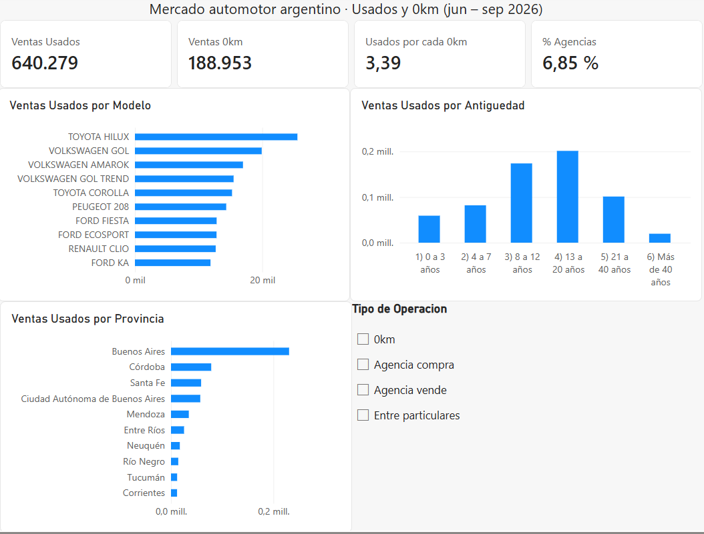

# Mercado automotor argentino: ¿qué autos usados conviene tener en stock?

Análisis de **829.232 operaciones reales** de autos usados y 0km registradas en Argentina entre junio y septiembre de 2026, con **BigQuery** (SQL) y **Power BI**.

---

## La pregunta de negocio

> Si tuvieras una agencia de autos usados en Argentina, ¿qué autos te conviene tener en stock?

Para responderla:
1. ¿Cómo se relaciona el mercado de usados con el de 0km?
2. ¿Qué marcas y modelos usados se venden más?
3. ¿De qué antigüedad son los usados que se venden?
4. ¿En qué provincias se concentra el mercado?
5. ¿Qué 0km se venden hoy (los usados del futuro)?
6. ¿Qué compran las agencias, a diferencia de los particulares?

## Datos

- **Fuente:** Dirección Nacional de los Registros Nacionales de la Propiedad del Automotor (DNRPA), portal de datos abiertos del Ministerio de Justicia ([datos.jus.gob.ar](https://datos.jus.gob.ar)).
- **Transferencias de autos usados:** 640.279 registros.
- **Inscripciones iniciales de 0km:** 188.953 registros.
- **Período:** junio a septiembre de 2026, un archivo CSV por mes.

## Herramientas y proceso

**Google BigQuery · SQL · Power BI · DAX**

El trabajo sigue un esquema **ELT** (extraer, cargar, transformar):

1. **Carga:** los 8 CSV mensuales se cargaron en BigQuery en dos tablas, con todas las columnas como texto para evitar errores de tipos entre archivos.
2. **Transformación:** una vista (`mercado_limpio`) une usados y 0km con `UNION ALL`, convierte tipos con `SAFE_CAST`, normaliza los modelos y calcula columnas nuevas (antigüedad, rango de antigüedad y tipo de operación).
3. **Análisis:** una consulta SQL por pregunta (ver [`consultas.sql`](consultas.sql)).
4. **Visualización:** Power BI conectado directo a BigQuery, con medidas DAX (`CALCULATE`, `KEEPFILTERS`, `DIVIDE`).

## Limpieza de datos: lo que se encontró

- **Modelos partidos en versiones.** "GOL 1.6", "GOL 1.4 L", etc. aparecían como modelos distintos. Se creó un *modelo base* con la primera palabra. Con esto, la **Toyota Hilux**, que no figuraba en el top 10, pasó a ser **el usado más vendido**.
- **Excepciones a la regla.** *Gol Trend* se mantuvo separado de *Gol* por ser un modelo distinto. Los modelos con prefijo "NUEVO" ("NUEVO SANDERO", "NUEVO LOGAN") se agruparon por su nombre real.
- **Años de modelo imposibles.** Se detectaron 63 registros con años como "20", "2206" o "2720", que se marcaron como sin dato. Los autos de más de 50 años **se conservaron**: cruzando marca y modelo se comprobó que son clásicos reales (Ford T, Dodge Brothers 1925, Fiat 509).
- **Provincias vacías** (1,5%), etiquetadas como "Sin dato".
- **Tipos de trámite desprolijos**, con espacios dobles y variantes. Se clasificaron con `LIKE` en tres grupos: *agencia compra*, *agencia vende* y *entre particulares*.

## Hallazgos

**1. Por cada 0km se venden 3,4 usados.**
La relación es estable mes a mes (entre 3,26 y 3,48). En la provincia de Buenos Aires llega a 4,46.

**2. El mercado está muy concentrado.**
Los usados más vendidos son Toyota Hilux, VW Gol, VW Amarok, VW Gol Trend y Toyota Corolla. En septiembre, 7 marcas concentraron el 83% de las ventas de usados.

**3. El pico está en autos de 8 a 12 años.**
El 58% de los usados vendidos tiene entre 8 y 20 años. Normalizando por la cantidad de años de cada rango, la franja con más ventas por año de modelo es la de **8 a 12 años** (unas 34.800 ventas por año de modelo, contra 25.200 en la de 13 a 20).

**4. Dos de cada tres usados se venden en cuatro distritos.**
Provincia de Buenos Aires (36%), Córdoba (12%), Santa Fe (9%) y CABA (9%).

**5. Los usados más vendidos de hoy ya no se fabrican.**
Los 0km más vendidos son Toyota Hilux, Toyota Yaris, Ford Ranger, Fiat Cronos, Ford Territory, VW Amarok, Toyota Corolla, Peugeot 208, VW Tera y Chevrolet Onix.
- **Hilux, Amarok, Corolla y 208** están en el top 10 de los dos mercados.
- **Gol, Fiesta, EcoSport, Clio y Ka** lideran entre los usados, pero no están entre los 0km: ya no se reponen.
- **Yaris, Cronos, Territory, Tera y Onix** están en el top de 0km pero todavía no en el de usados: son los usados del futuro.

**6. Las agencias trabajan con autos de la mitad de antigüedad.**
Lo que compran y venden las agencias tiene en promedio **7,6 años**, contra **15 años** entre particulares. Evitan los modelos discontinuados y ya compran Cronos, Onix y Sandero.

## Recomendaciones para una agencia de usados

1. **Concentrar el stock en autos de 8 a 12 años** (modelos 2014-2018).
2. **Apuestas seguras:** Hilux, Amarok, Corolla y 208, que lideran tanto en usados como en 0km.
3. **Las pickups son clave:** Hilux y Amarok están en el top 10 de usados y de 0km, y la Ranger es el tercer 0km más vendido.
4. **Prepararse para el recambio:** a medida que Gol, Fiesta y Ka envejezcan, migrar el stock hacia Cronos, Onix, Yaris y Territory.

## Limitaciones

- Los datos miden **cantidad de operaciones, no precios ni ganancia**: un modelo puede venderse menos y dejar más margen.
- La participación de las agencias (6,9%) está **subestimada**: muchas operan con el formulario 08 firmado, sin poner el auto a su nombre, y esas ventas figuran como "entre particulares".
- La provincia corresponde al **registro donde se hizo el trámite**, no necesariamente al domicilio del comprador.
- Septiembre tuvo más ventas que los meses anteriores en los dos mercados. La diferencia es compatible con la menor cantidad de feriados del mes, por lo que no se interpretó como un cambio de demanda.

## Archivos

- `consultas.sql`: todas las consultas de carga, limpieza y análisis.
- `Mercado_Automotor.pbix`: tablero de Power BI.
- `tablero.png`: captura del tablero.
